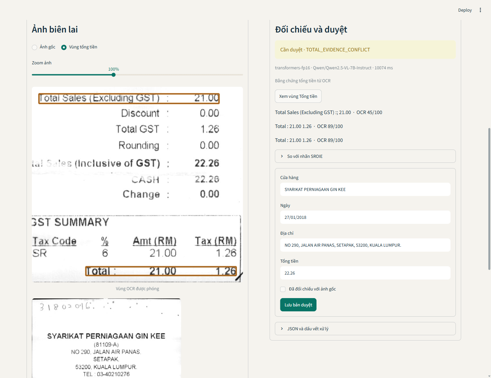
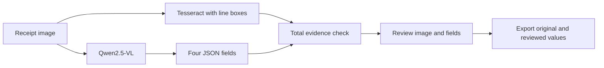

# Qwen Receipt Review

**A receipt extraction and human review workbench.** Qwen reads the scan, an independent OCR check looks for conflicting totals, and a reviewer can inspect the evidence before exporting JSON.

[Measured pilot](#measured-pilot) · [Review case](#review-case) · [Full evaluation workflow](docs/evaluation.md) · [GPU pilot notebook](qwen_sroie_gpu.ipynb)



## Measured pilot

Qwen2.5-VL-7B-Instruct FP16 and Tesseract + rules processed the **same 20 held-out SROIE receipts** in one Kaggle session with two NVIDIA T4 GPUs. Counts are normalized exact matches against the dataset labels.

| Pipeline | Total exact | All four fields exact | Median time / receipt |
| --- | ---: | ---: | ---: |
| Qwen2.5-VL-7B-Instruct FP16 | **20/20** | **12/20** | 10.02 s |
| Tesseract + extraction rules | 9/20 | 0/20 | **0.85 s** |


The measured Qwen path includes the independent OCR check. Times are per receipt after model loading and exclude ZIP reads, image preparation, and the UI. The sample is a pilot, so the counts describe these 20 receipts. The full dataset benchmark covers the two OCR baselines across 337 receipts. [Qwen pilot summary and model revision](qwen-pilot20-summary.json) · [Full OCR baseline](benchmark-v2-summary.json)

## Review case

Receipt **X51005677336** has a pretax amount of **21.00**, GST of **1.26**, and a final total of **22.26**. The OCR baseline with dataset transcripts assigned **1.26** to the total field and passed format validation. Qwen extracted **22.26** and matched all four labels. The runtime OCR check still identified conflicting amount candidates, so the workbench kept the receipt in **Needs review**.

This gate kept 15 of the 20 Qwen predictions for review. Of the five that passed, one still missed at least one field. That trade-off is visible in the report and gives a concrete next experiment: use OCR line context to distinguish final totals from tax summaries, then measure both review load and errors that get through on held-out data.

## Pipeline



The four fields are `company`, `date`, `address`, and `total`. The reviewer can zoom the scan, highlight candidate OCR lines, correct values, and export the original and corrected records. The benchmark view groups reports by identical receipt IDs and can compare stores seen and unseen in the training split.

The dataset audit found seven identical-image hashes shared by train and test, plus three additional duplicate test receipts. The cleaned test has **337 receipts**. Exact hashes cover byte-identical files. Store groups use normalized company and address. [Dataset audit](data-audit.json) · [SROIE v2 on Kaggle](https://www.kaggle.com/datasets/urbikn/sroie-datasetv2)

## Run it

### Reproduce the GPU pilot

Import [qwen_sroie_gpu.ipynb](qwen_sroie_gpu.ipynb) into a GPU notebook, enable Internet, and choose a runtime with enough memory for the FP16 checkpoint. The verified run used Kaggle T4 ×2. The notebook checks the dataset hash, loads the pinned checkpoint, runs a one-image smoke test, then evaluates the same 20 receipts with all three methods. Download `qwen-pilot20.json` and `tesseract-pilot20.json` into `work/receipt-v2/`.

### Run the 337-receipt evaluation

The full Qwen experiment uses a resumable CLI on CUDA. Each receipt commits to SQLite before the next begins. Both image pipelines use the same ordered IDs. The report compares three review policies per prediction, keeps malformed outputs and failures, and records inference, OCR, validation and preprocessing times. The measured Qwen result above still covers 20 receipts. [Commands, metrics and evaluation limits](docs/evaluation.md)

### Open the workbench

Run from the repository root with Python 3.11+. Install Tesseract with English language data. On Windows the CLI also checks the standard Program Files location. Set `RECEIPT_TESSERACT` to the executable path for another installation.

```powershell
New-Item -ItemType Directory -Path work -Force | Out-Null
curl.exe -fL https://www.kaggle.com/api/v1/datasets/download/urbikn/sroie-datasetv2 -o work/sroie-kaggle.zip
python -m pip install -r requirements-review.txt
python receipt_pipeline.py benchmark --archive work/sroie-kaggle.zip --method tesseract --limit 20 --output work/receipt-v2/tesseract-local-pilot20.json
python -m streamlit run review_app.py --server.address 127.0.0.1
```

In **Benchmark**, select a cohort and report. For the screenshot case, choose Qwen, receipt `X51005677336`, then **Xem vùng Tổng tiền** (show total region). The UI labels are in Vietnamese. To use a different data directory, set `RECEIPT_REVIEW_WORK` to its path.

The **Đọc ảnh mới** tab uses local Ollama and expects `qwen2.5vl:7b` at `127.0.0.1:11434`. The published metrics were measured with the official FP16 checkpoint on Kaggle. Live Ollama inference is a separate optional path that still needs validation on the target machine.

## Sources and scope

[SROIE competition](https://arxiv.org/abs/2103.10213) · [Qwen2.5-VL model card](https://huggingface.co/Qwen/Qwen2.5-VL-7B-Instruct) · [Tesseract TSV documentation](https://tesseract-ocr.github.io/tessdoc/Command-Line-Usage.html)

The repository contains code, illustrative screenshots from the public dataset, and aggregate evaluation reports. Download the source dataset separately. The notebook and summaries identify the exact checkpoint and cohort used for the pilot.
