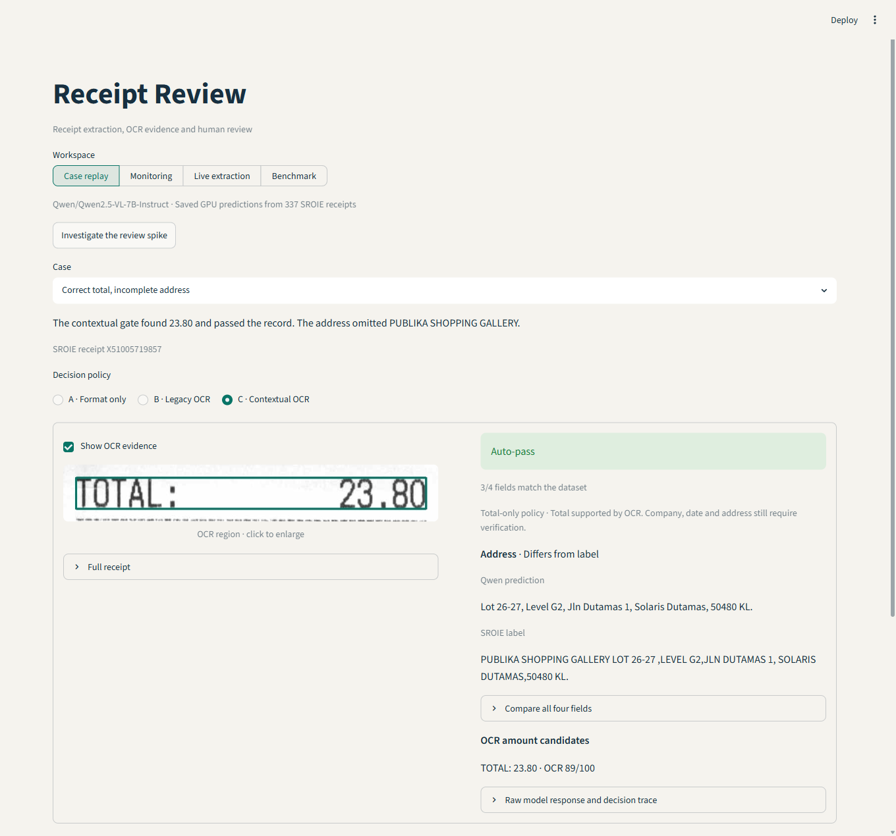
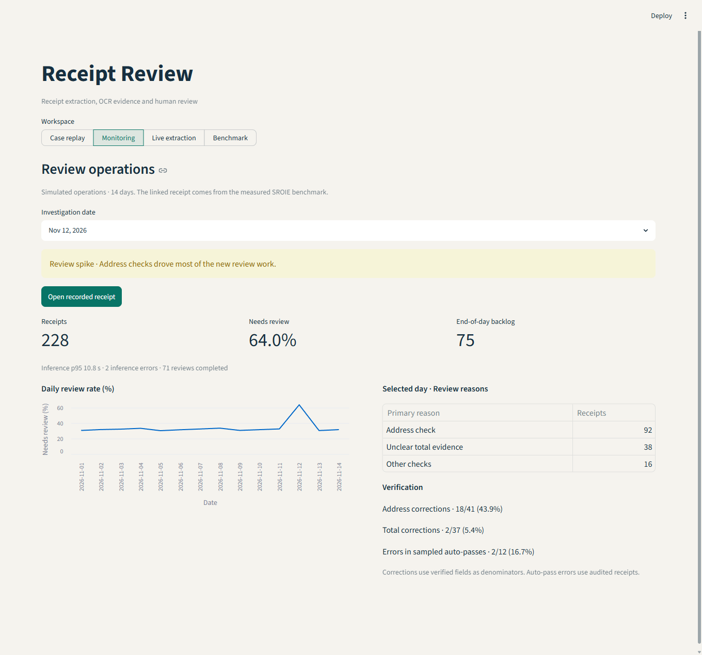
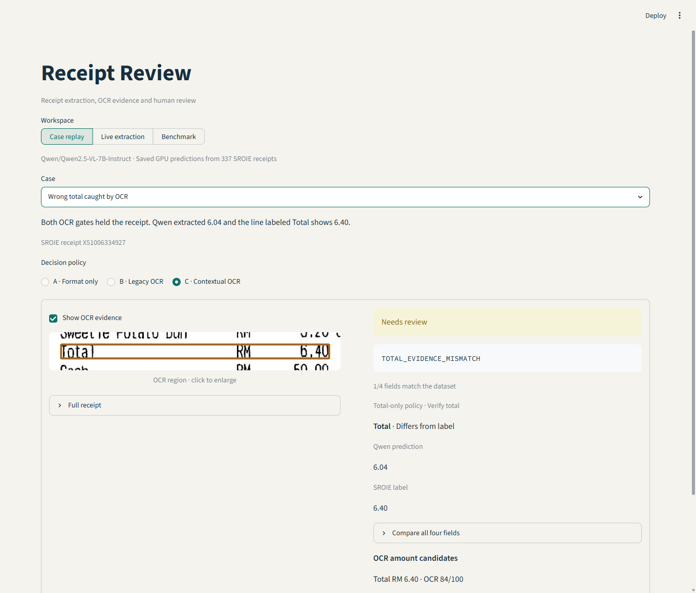
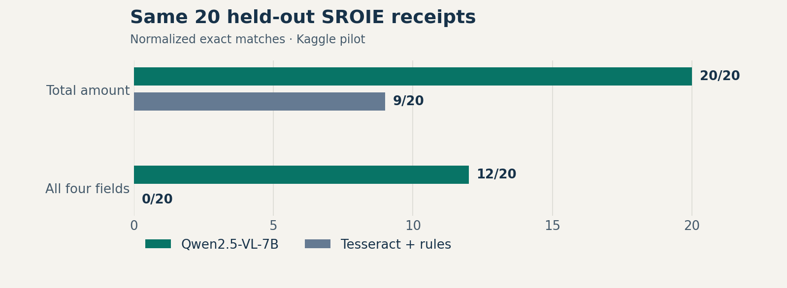
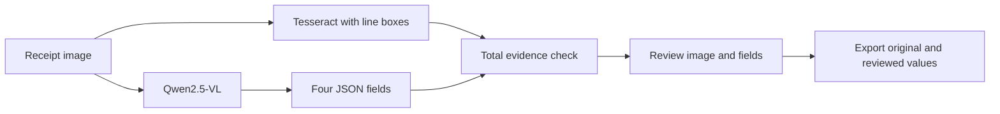

# Qwen Receipt Review

**The total was correct. The receipt still needed a closer look.**



Qwen2.5-VL turns receipt scans into structured JSON. Tesseract checks the amount against the scan, and a reviewer can correct fields before export. In this recorded case, the total check passes while the address is incomplete.

[Walk through the incident](#walk-through-the-incident) · [Input and output](#input-and-output) · [Full benchmark](#full-benchmark) · [Reproduce](docs/evaluation.md#reproduce)

## Walk through the incident

```bash
python -m pip install -r requirements-review.txt
python -m streamlit run review_app.py
```

In **Case replay**, select **Investigate the review spike**. The walkthrough runs on CPU with bundled assets.

1. **Detect the spike.** On November 12, the simulated review rate rises to 64.0%. Reviewers correct 18 of 41 verified addresses, while total corrections stay at 2 of 37 verified amounts. An audit of auto-passes finds 2 incorrect records in a sample of 12.
2. **Inspect the receipt.** Open the linked SROIE example. OCR supports `23.80`. Switch from gate B to C and watch the decision change to auto-pass even though the model omitted the shopping gallery from the address.
3. **Decide whether to ship.** In a measured ten-receipt development test, the candidate prompt removed an extra `AEON SHAH ALAM` line on one receipt and added the `Bentong-2` branch header to a previously correct address. Exact address match stayed at 3/10. The candidate failed the clean-control check, so the original prompt stayed in place. [Experiment result](docs/evaluation.md#result-on-ten-diagnostic-receipts)



The daily workload and audit counts are simulated. The linked scan, predictions, and A/B result come from recorded Qwen runs.

## Input and output

| Step | Recorded example from SROIE receipt `X51006334927` |
| --- | --- |
| **Input** | A JPEG or PNG receipt. [Open the sample scan](assets/replay/X51006334927.webp). |
| **Qwen output** | Four JSON fields. The model predicted `"total": "6.04"`. |
| **OCR evidence** | Tesseract found `Total RM 6.40` on the scan. |
| **Review decision** | **Needs review** because the two amounts disagree. The reviewer inspects the scan, corrects the fields, and approves the export. |
| **Approved output** | JSON with `original` and `reviewed` field values, the approval timestamp, and the reasons that triggered review. |

<details>
<summary>See the OCR evidence and extracted JSON</summary>



This is the parsed Qwen prediction before human review.

```json
{
  "company": "BIRU PETROLEUM",
  "date": "17/11/16",
  "address": "KELANA JAYA, 47301 PETALING SELANGOR DARUL EHSAN.",
  "total": "6.04"
}
```

</details>

## Explore the recorded cases

Choose a receipt and switch between gates A, B and C to see the decision, OCR region, Qwen response and SROIE label.

| Receipt | What to inspect |
| --- | --- |
| `X51005677336` | Qwen matches all four labels. OCR surfaces conflicting amounts and holds the receipt. |
| `X51006334927` | Qwen reads 6.04. The OCR line shows 6.40, so both evidence gates hold it. |
| `X51005719857` | OCR supports 23.80. Gate C passes the receipt even though the address omits the shopping gallery. |

## Full benchmark

Qwen2.5-VL-7B-Instruct FP16 ran on two Tesla T4 GPUs. The Kaggle run verified the same 337 SROIE test IDs and dataset hash for Qwen and Tesseract. Counts use normalized exact match.

| Pipeline | Total | All four fields | Median extraction with legacy OCR gate |
| --- | ---: | ---: | ---: |
| Qwen2.5-VL-7B-Instruct FP16 | **328/337** | **185/337** | 10.59 s |
| Tesseract + rules | 137/337 | 4/337 | 1.16 s |

The legacy OCR gate routed **288/337** Qwen predictions to review, including **158** that matched all four labels. The contextual gate routed **261/337** to review and let **28** incorrect records through, compared with **22** for the legacy gate. Both routed **8 of 9** wrong totals to review. A total-only policy supported **82/337** totals, including **one wrong total**. It leaves the other three fields for verification. [Qwen report](docs/qwen-full-summary.json) · [Paired Tesseract report](docs/tesseract-kaggle-summary.json) · [Evaluation protocol](docs/evaluation.md)

## Measured pilot

Qwen2.5-VL-7B-Instruct FP16 and Tesseract + rules processed the **same 20 held-out SROIE receipts** in one Kaggle session with two NVIDIA T4 GPUs. Counts are normalized exact matches against the dataset labels.

| Pipeline | Total exact | All four fields exact | Median time / receipt |
| --- | ---: | ---: | ---: |
| Qwen2.5-VL-7B-Instruct FP16 | **20/20** | **12/20** | 10.02 s |
| Tesseract + extraction rules | 9/20 | 0/20 | **0.85 s** |



The measured pilot Qwen path includes the independent OCR check. Pilot times are per receipt after model loading and exclude ZIP reads, image preparation, and the UI. The full benchmark above uses the newer runner, which includes image preparation in its timing. [Qwen pilot summary and model revision](qwen-pilot20-summary.json) · [Historical full OCR baseline](benchmark-v2-summary.json)

## Review case

Receipt **X51005677336** has a pretax amount of **21.00**, GST of **1.26**, and a final total of **22.26**. The OCR baseline with dataset transcripts assigned **1.26** to the total field and passed format validation. Qwen extracted **22.26** and matched all four labels. The runtime OCR check still identified conflicting amount candidates, so the workbench kept the receipt in **Needs review**.

The gate held 15 of the 20 pilot predictions. One of the five that passed still missed a field. The full benchmark measures this trade-off on all 337 receipts.

## Pipeline



The four fields are `company`, `date`, `address`, and `total`. The reviewer can zoom the scan, highlight candidate OCR lines, correct values, and export the original and corrected records. The benchmark view groups reports by identical receipt IDs and can compare stores seen and unseen in the training split.

The dataset audit found seven identical-image hashes shared by train and test, plus three additional duplicate test receipts. The cleaned test has **337 receipts**. Exact hashes cover byte-identical files. Store groups use normalized company and address. [Dataset audit](data-audit.json) · [SROIE v2 on Kaggle](https://www.kaggle.com/datasets/urbikn/sroie-datasetv2)

## Run it

### Reproduce the GPU pilot

Import [qwen_sroie_gpu.ipynb](qwen_sroie_gpu.ipynb) into a GPU notebook, enable Internet, and choose a runtime with enough memory for the FP16 checkpoint. The verified run used Kaggle T4 ×2. The notebook checks the dataset hash, loads the pinned checkpoint, runs a one-image smoke test, then evaluates the same 20 receipts with all three methods. Download `qwen-pilot20.json` and `tesseract-pilot20.json` into `work/receipt-v2/`.

### Run the 337-receipt evaluation

The full Qwen experiment uses a resumable CLI on CUDA. Each receipt commits to SQLite before the next begins. Both image pipelines use the same ordered IDs. The report compares three review policies per prediction, keeps malformed outputs and failures, and records inference, OCR, validation and preprocessing times. [Commands, metrics and evaluation limits](docs/evaluation.md)

### Open the workbench

Run from the repository root with Python 3.11+. Install Tesseract with English language data. On Windows the CLI also checks the standard Program Files location. Set `RECEIPT_TESSERACT` to the executable path for another installation.

```powershell
New-Item -ItemType Directory -Path work -Force | Out-Null
curl.exe -fL "https://api.kaggle.com/v1/datasets/download/urbikn/sroie-datasetv2?datasetVersionNumber=4" -o work/sroie-kaggle.zip
python -m pip install -r requirements-review.txt
python receipt_pipeline.py benchmark --archive work/sroie-kaggle.zip --method tesseract --limit 20 --output work/receipt-v2/tesseract-local-pilot20.json
python -m streamlit run review_app.py --server.address 127.0.0.1
```

In **Benchmark**, select a cohort and upload a row-level report from the full runner, or put it in `work/receipt-v2/`. To use a different data directory, set `RECEIPT_REVIEW_WORK` to its path.

The **Live extraction** tab uses local Ollama and expects `qwen2.5vl:7b` at `127.0.0.1:11434`. The published metrics were measured with the official FP16 checkpoint on Kaggle. Live Ollama inference is a separate optional path that still needs validation on the target machine.

## Sources and scope

[SROIE competition](https://arxiv.org/abs/2103.10213) · [Qwen2.5-VL model card](https://huggingface.co/Qwen/Qwen2.5-VL-7B-Instruct) · [Tesseract TSV documentation](https://tesseract-ocr.github.io/tessdoc/Command-Line-Usage.html)

The repository includes three SROIE sample scans and their recorded predictions for case replay. The full dataset is downloaded separately. Kaggle identifies the original ICDAR challenge organizers as the data source. [SROIE Kaggle data card](https://www.kaggle.com/datasets/urbikn/sroie-datasetv2)
